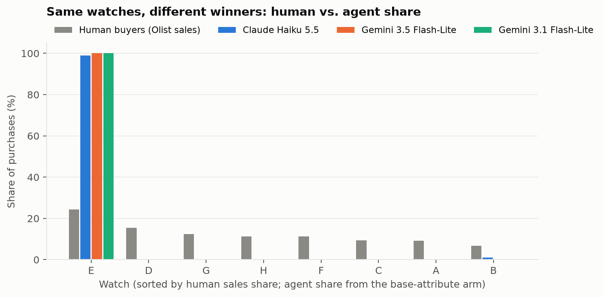
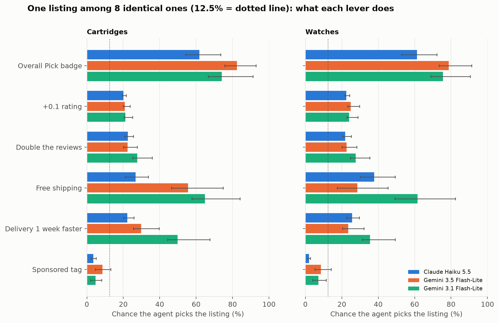

# What wins an AI shopping agent?

**A controlled experiment on real Olist products: how LLM shopping agents choose, how AI models differ, and how agents differ from human customers.**

Part of a Customer Analytics group project (IE University). The project is an *acquisition* story: only 2.15% of Olist's customers ever come back on a later day, so nearly every sale is won from scratch. This repository holds the agent side: what wins an AI agent's first purchase.

[](https://colab.research.google.com/github/marevalo22/ai-shopping-agents-olist/blob/main/notebooks/agent_experiment.ipynb)

## Key findings

| | Finding |
|---|---|
| 1 | **Winner-takes-all.** On the real Olist watch shelf, all three models buy the same watch 99–100% of the time. Humans bought it 24% of the time and spread the rest over all eight watches. |
| 2 | **The "Overall Pick" badge beats everything; "Sponsored" backfires.** A badge lifts one of 8 identical listings from 12.5% to 60–80%. A Sponsored tag drops it to 2–9%. Free shipping is a top-three lever (27–65%). |
| 3 | **Position effects flip between models.** With identical products, Gemini 3.5 buys the first listing ~37% of the time, Claude Haiku ~2%, Gemini 3.1 shows no clear effect. A model update is a demand shock. |
| 4 | **Price equivalents (cartridges).** +0.1 stars ≈ 23–37% of price, double the reviews ≈ 27–49%, one week faster delivery ≈ 45%. R$1 of shipping weighs like ~R$3 of price. |
| 5 | **A newcomer cannot buy its way in.** A 5-review listing won 0 of 300 shopping lists even at 50% off. The choice model predicts it would need a 78–98% discount. 25–100 reviews or a badge do work. |
| 6 | **Stated ≠ revealed.** Agents mention every attribute, but rating does most of the deciding, and position matters without ever being mentioned. |




## Design

The headless design of **ACES** (Allouah, Besbes, Figueroa, Kanoria & Kumar, 2025, [arXiv:2508.02630](https://arxiv.org/abs/2508.02630)), on real products:

1. **Shelf from Olist.** `scripts/build_catalog.py` picks 8 wristwatches and 8 ink cartridges from the [Olist Brazilian E-Commerce dataset](https://www.kaggle.com/datasets/olistbr/brazilian-ecommerce). It identifies the product type from review text, keeps products with at least 30 delivered orders, and records each product's real median price, mean rating, review count, promised delivery days, freight and human sales share. Products get neutral labels ("Watch A"…"Watch H") because Olist has no names or brands.
2. **Randomized shopping lists.** Each list shuffles the order and randomizes price, rating, review count, delivery, freight and tags (Sponsored, Overall Pick, scarcity) around the real values (ACES Table 1).
3. **Agents.** Claude Haiku 5.5, Gemini 3.5 Flash-Lite and Gemini 3.1 Flash-Lite (cheapest tiers, reasoning off or minimal) get the ACES headless prompt plus one "unblinding" line (Gui & Toubia, [arXiv:2312.15524](https://arxiv.org/abs/2312.15524)) and return a JSON choice with a reason.
4. **Runs.** Choice experiment (2,200), base shelf at real values (600), cold start for a new listing (780). Total API cost **US$0.67**.
5. **Analysis.** Conditional logit per model and category with product fixed effects; ACES price headroom and choice-probability lift; bootstrap CIs clustered by shopping list; cold-start win rates with Wilson intervals; keyword coding of stated reasons.

## Repository layout

```
configs/      models.yaml, experiment configs, the two product catalogs
src/agentshop/
  scenarios.py   randomized shopping lists (seeded)
  prompts.py     ACES headless prompt
  providers.py   async Anthropic / Gemini / OpenAI calls with retries and rate limits
  runner.py      resumable runs, JSONL logging of every request and response, cost ledger
  parse.py       robust JSON parsing with status codes (nothing silently dropped)
  analysis.py    conditional logit, headroom, lift, cold start, stated vs. revealed, charts
scripts/      build_catalog.py, run_analysis.py, run_all.sh
data/logs/       raw request/response logs (JSONL)
data/processed/  parsed choices (parquet), human shares
reports/      figures/ and tables/ produced by run_analysis.py
notebooks/    agent_experiment.ipynb: the write-up (runs without API keys)
```

## How to run

Reproduce the analysis from the committed results (no API keys, no cost):

```bash
uv venv --python 3.11 && uv pip install -e . jupyter
.venv/bin/python scripts/run_analysis.py --boot 200   # ~20 min; writes reports/figures and reports/tables
.venv/bin/jupyter lab notebooks/agent_experiment.ipynb
```

Or open the notebook in Colab with the badge above.

Re-running the experiment needs API keys in `.env` (see `.env.example`) and the Olist CSVs in `data/raw/olist/` (from Kaggle, not redistributed here):

```bash
.venv/bin/python scripts/build_catalog.py
.venv/bin/python -m agentshop.cli plan configs/experiments/choice.yaml        # cost estimate, no calls
.venv/bin/python -m agentshop.cli run configs/experiments/choice.yaml --yes   # execute (resumable)
```

## Limitations

Simulated agents on the cheapest model tiers. Neutral labels, so we measure attributes, not brands. Listings are reconstructed from transactions (no titles or photos). Human data is observational while the agent data is experimental, so the comparison is directional. One default "typical person" prompt against many different humans. Review count partly encodes past human sales. Cold start is Claude Haiku only, 30 lists per arm. Brazil 2016–2018, prices in R$. See the notebook, Section 5.11.8.

## References

- Allouah, A., Besbes, O., Figueroa, J. D., Kanoria, Y., & Kumar, A. (2025). *What Is Your AI Agent Buying? Evaluation, Biases, Model Dependence, & Emerging Implications for Agentic E-Commerce.* [arXiv:2508.02630](https://arxiv.org/abs/2508.02630)
- Gui, G., & Toubia, O. (2023). *The Challenge of Using LLMs to Simulate Human Behavior: A Causal Inference Perspective.* [arXiv:2312.15524](https://arxiv.org/abs/2312.15524)
- Horton, J. J., Filippas, A., & Manning, B. S. (2023). *Large Language Models as Simulated Economic Agents.* [arXiv:2301.07543](https://arxiv.org/abs/2301.07543)
- Reusens, M., et al. (2026). *Would a Large Language Model Pay Extra for a View?* [arXiv:2602.09802](https://arxiv.org/abs/2602.09802)
- Microsoft Research (2025). *Magentic Marketplace.* [arXiv:2510.25779](https://arxiv.org/abs/2510.25779)
- Olist (2018). *Brazilian E-Commerce Public Dataset.* [Kaggle](https://www.kaggle.com/datasets/olistbr/brazilian-ecommerce)
